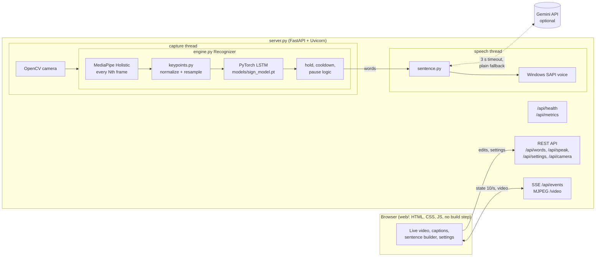

# SignSpeak AI

Real-time **American Sign Language (ASL)** recognition from an ordinary webcam. SignSpeak AI watches you sign, tracks your body and hands with MediaPipe, and classifies the sign with a small LSTM neural network, live on a laptop CPU.

> Semester mini project. Goal: webcam → sign recognition → text → speech.
> Status: the full pipeline works end to end: recognition, sentence assembly, speech and a web UI, with automated tests, CI and a Docker image (see [Roadmap](#roadmap)).


https://github.com/user-attachments/assets/65c1498e-6b9a-4fbd-b426-43c88bf97f65


*36-second launch video. Click the image to play it.*

---

## Contents

- [How it works](#how-it-works)
- [System architecture](#system-architecture)
- [Current vocabulary and results](#current-vocabulary-and-results)
- [Requirements](#requirements)
- [Installation](#installation)
- [Quick start: the web app](#quick-start-the-web-app)
- [Quick start: run the live demo](#quick-start-run-the-live-demo)
- [Full pipeline: train your own model](#full-pipeline-train-your-own-model)
- [Testing and CI](#testing-and-ci)
- [Docker](#docker)
- [Adding data from other people or datasets](#adding-data-from-other-people-or-datasets)
- [Project structure](#project-structure)
- [Design decisions](#design-decisions)
- [Troubleshooting](#troubleshooting)
- [Limitations](#limitations)
- [Roadmap](#roadmap)
- [License](#license)
- [Acknowledgements](#acknowledgements)

---

## How it works

```
 webcam / video
      │
      ▼
 MediaPipe Holistic ──► 258 numbers per frame
 (body + both hands)     • 33 body points × (x, y, z, visibility)
                         • 21 left-hand points × (x, y, z)
                         • 21 right-hand points × (x, y, z)
      │
      ▼
 Normalize ──► relative to the shoulders, scaled by shoulder width
               (works no matter where you stand or how far from the camera)
      │
      ▼
 Resample ──► 30 evenly spaced frames per sign
      │
      ▼
 LSTM classifier ──► one probability per sign ──► "hello" (94%)
```

- **Keypoints, not pixels.** The model never sees the image, only body and hand coordinates. That makes it fast, lighting-independent, and trainable on a few hundred clips.
- **A sequence model.** Most signs are movements, not poses, so an LSTM reads the 30 frames in order.
- **A `nothing` class.** The model is trained on idle movement *and* on 50 unrelated ASL signs labelled `nothing`, so it learns to stay quiet instead of forcing every gesture into a known word.

## System architecture



- **Two threads, one process.** The capture thread reads the camera and runs recognition; the speech thread phrases and speaks sentences, so a slow network or voice never freezes the video.
- **The browser only displays.** Video arrives as an MJPEG stream and live state as server-sent events (10 per second). Everything the user changes goes back over a small REST API, which validates every input.
- **`engine.py` is the single source of recognition logic.** Both front ends use it: the web app (`server.py`) and the OpenCV window (`live_predict.py`).

## Current vocabulary and results

| Class | Meaning |
|---|---|
| `hello`, `help`, `no`, `please`, `sorry`, `thank_you`, `yes` | ASL signs: greetings, politeness, answers |
| `me`, `you`, `what`, `where`, `want`, `water` | ASL signs: people, questions, needs |
| `nothing` | no sign / unknown sign (idle movement plus 50 unrelated ASL signs) |

Trained on about 630 clips: the author's own recordings, a second signer, and about 30 clips per sign from the [ASL Citizen](https://www.microsoft.com/en-us/research/project/asl-citizen/) dataset (42 different signers, everyday webcams).

**Accuracy: 82.5% across 14 classes** (5-fold cross-validation over 628 clips, so every clip is tested once; fold std 1.7%). Strongest: want, sorry, please (96–98%). Weakest: where (65%), me (66%), yes (68%). Run `python train.py --cv` to reproduce.

## Requirements

- **Python 3.10 or 3.11.** Avoid 3.12+, because `mediapipe==0.10.14` doesn't support it.
- A **webcam** for recording and the live demo.
- Windows 11 recommended (developed and tested there; spoken output uses the Windows voice). No GPU needed.

## Installation

```bash
git clone https://github.com/Zmy-Shaurya/SignSpeak-AI.git
cd SignSpeak-AI

# create and activate a virtual environment
python -m venv .venv
.venv\Scripts\activate          # Windows
# source .venv/bin/activate     # macOS / Linux

# PyTorch (CPU build, much smaller than the default GPU build)
pip install torch --index-url https://download.pytorch.org/whl/cpu

# everything else
pip install -r requirements.txt
```

Check it works:

```bash
python keypoints.py
```

This should print `keypoints.py self-check passed`.

> **Note:** `mediapipe` is pinned to `0.10.14` on purpose, because newer releases removed the `mp.solutions` API this project uses. MediaPipe installs `opencv-contrib-python` itself. Don't also install `opencv-python`, because the two conflict.

## Quick start: the web app

```bash
python server.py
```

Open http://localhost:8000. Options: `--camera 1` (start on another camera), `--backend dshow` (if a camera won't open on Windows), `--port 8080`.

- **Camera:** pick a camera from the list, or press **Try next camera** if the current one fails. The badges on the video show whether your body and each hand are being tracked. A warning appears if your shoulders leave the frame, because every sign is measured relative to them.
- **Signing:** the detected sign appears as a caption on the video. The bar under it fills while the sign is held; when it's full the word is accepted.
- **Sentence builder:** accepted words appear as chips. Drag them to reorder (or focus one and press Shift+Arrow), press × or Delete to remove one, and click any sign in the **Vocabulary** grid to add a word the model missed. Pause to finish the sentence, or press **Speak now**. **Repeat last** says the last sentence again.
- **Settings:** confidence threshold, hold frames, pause length, and how often frames are analysed (every frame, or 1 in 2 or 3 to save CPU).
- **Shortcuts:** `S` speak now, `C` clear words, `M` mute, `N` next camera.

### API

Interactive documentation is generated at http://localhost:8000/docs.

| Endpoint | Purpose |
|---|---|
| `GET /video` | MJPEG stream of the annotated camera feed |
| `GET /api/events` | Server-sent events: live state 10 times per second |
| `GET /api/state` | The same state, once |
| `GET /api/health` | Liveness and camera status (`ok` / `degraded`) |
| `GET /api/metrics` | fps, inference latency (mean, p50, p95), counters, model version |
| `GET /api/cameras` | Probe camera indices 0 to 4 |
| `POST /api/camera` | Switch camera: `{"index": 1}` |
| `POST /api/settings` | Any of `threshold`, `hold`, `pause`, `stride`, `mute` |
| `PUT /api/words` | Replace the word list (reorder, delete, add); unknown signs are rejected |
| `POST /api/speak` | Finish the sentence now |
| `POST /api/repeat` | Speak the last sentence again |
| `POST /api/clear` | Drop the current words |

The model version shown in the UI and in `/api/metrics` is the first 12 characters of the checkpoint's SHA-256, so every retrain is identifiable.

## Quick start: run the live demo

A trained model is included at `models/sign_model.pt`.

```bash
python live_predict.py --camera 0
```

- Stand **waist-up in frame, with both shoulders visible**.
- Wait for "warming up…" to disappear (about 3 seconds), then sign.
- The big text shows the recognized sign; `...` means nothing or not confident. The small text shows every class's probability.
- Once a sign wins 5 frames in a row it's **accepted** and added to the word line at the bottom. The window then refills (about 3 s) before the next sign, so one movement is never counted twice.
- **Pause for about 2 seconds** to finish a sentence: the words are turned into an English sentence, shown on screen and **spoken aloud**.
- Press **`c`** to clear the words and **`q`** to quit.

### Natural sentences with Gemini (optional)

By default the sentence is the signs joined in order ("Hello, help, please."). With a free [Google AI Studio](https://aistudio.google.com/) API key, Gemini rewrites them into natural English ("Hello! I need help, please."):

```bash
setx GEMINI_API_KEY "your-key-here"
```

Then open a **new** terminal. Alternatively, put `GEMINI_API_KEY=your-key-here` in a `.env` file in the project root (it's gitignored). The key is never stored in the code. Only the recognized words are sent to Gemini, never video. If the key is missing, the internet is down or Gemini takes longer than 3 seconds, the plain sentence is used, so the demo keeps working offline.

Speech uses Windows' built-in voice (SAPI), so the live demo currently needs Windows. Recording, extraction and training work on any OS.

| Option | Default | Meaning |
|---|---|---|
| `--camera` | `0` | Webcam index. Try `1` or `2` if `0` isn't your camera. |
| `--seconds` | `3.0` | Length of the sliding window. Keep it equal to the recording length. |
| `--threshold` | `0.9` | Minimum confidence before a sign is shown. |
| `--hold` | `5` | Frames in a row a sign must win before it's accepted. Raise it if signs fire too easily. |
| `--pause` | `2.0` | Seconds of not signing that end a sentence. |
| `--stride` | `2` | Analyse every Nth frame (1 = every frame). Higher saves CPU; `--hold` counts analysed frames. |
| `--model` | `gemini-3.5-flash-lite` | Gemini model used to phrase sentences. |

The prediction looks at the last 3 seconds as a whole, so a sign appears shortly after you finish it and stays for up to 3 seconds.

## Full pipeline: train your own model

Four commands, each run from the project root.

### 1. Record clips

```bash
python record_videos.py hello --camera 0
```

- Press **SPACE**. You get a 2-second countdown, then it records 3 seconds automatically, so your hands stay free.
- Do one sign per clip: hands down, sign, hands down.
- Record **20–30 clips per sign**, varying speed, position and distance slightly.
- Record a `nothing` class too: standing still, scratching your face, fidgeting.
- Press **`q`** when done. Clips are saved to `data/videos/<sign>/`.

The folder name **is** the label. To add a new sign, just record into a new name (use `snake_case`, for example `thank_you`).

### 2. Extract keypoints

```bash
python extract_dataset.py
```

Every clip in `data/videos/<sign>/` becomes `data/keypoints/<sign>/<clip>.npy`, a `(30, 258)` array.

- **Incremental:** already-extracted clips are skipped, so just re-run after adding videos.
- **Quality checks:** clips are skipped (with a reason printed) if your shoulders aren't visible in most frames or the clip is longer than 6 seconds.
- **Re-extracting:** to redo everything, delete `data/keypoints/` and run again.

### 3. Train

```bash
python train.py
```

This prints the training/test accuracy every 10 epochs and a confusion matrix at the end, then saves `models/sign_model.pt`. 20% of each sign is held out for testing. It takes about 1–2 minutes on a laptop CPU.

| Option | Meaning |
|---|---|
| `--cv` | 5-fold cross-validation instead: every clip is tested once, much steadier than one 20% split. No model is saved. About 12 minutes. |
| `--weights balanced` | Weight each sign's loss by 1 / its clip count, so small classes matter as much as the large `nothing` class. |
| `--boost where=1.5,me=1.5` | Extra loss weight for specific signs the model confuses. |
| `--epochs 400` | Training length. |

Every run (settings, accuracy, per-sign accuracy) is appended to `models/train_log.jsonl`, which is the experiment history.

### 4. Run it live

```bash
python live_predict.py --camera 0
```

## Testing and CI

```bash
pip install -r requirements-dev.txt
python -m pytest
```

The suite (`tests/`) runs in about 15 seconds and needs no camera:

| File | Covers |
|---|---|
| `test_keypoints.py` | Normalization is position- and distance-invariant; missing parts stay zero; resampling |
| `test_engine.py` | Hold-to-accept, cooldown, low confidence and `nothing` never accepted, pause ends the sentence, speak-now; plus MediaPipe and the shipped model end to end on blank frames |
| `test_sentence.py` | Plain fallback, Gemini reply parsing (network mocked), key sent as a header, timeout fallback |
| `test_train.py` | Model output shape, augmentation keeps missing hands at zero, class weights |
| `test_server.py` | The real API against a camera that doesn't exist: health, metrics, input validation, word editing, speak and repeat |

GitHub Actions (`.github/workflows/ci.yml`) runs the self-checks and the tests on Windows and Linux for every push and pull request.

## Docker

```bash
docker build -t signspeak .
docker run -p 8000:8000 --device /dev/video0 -e GEMINI_API_KEY signspeak
```

- Webcam access needs a **Linux host** (`--device /dev/video0`). Docker Desktop on Windows and macOS can't pass a webcam into a container: there, run `python server.py` directly. Without a camera the container still serves the UI and API and reports a camera error.
- Speech uses the Windows voice, so in the container sentences are shown as text only.
- `.env`, raw videos and the virtual environment are excluded by `.dockerignore`; pass the Gemini key at run time with `-e`.
- The image has a health check on `/api/health` and runs as a non-root user.

## Adding data from other people or datasets

`extract_dataset.py` handles any video (`.mp4 .mov .avi .mkv .webm`) the same way as webcam recordings: put clips into `data/videos/<sign>/` and run steps 2–3.

**Videos from friends (phone)**
- Prop the phone up and film from the front, **waist up, both shoulders in frame**.
- One sign per video, about 3 seconds.
- Send it via Google Drive, or WhatsApp **as a document**, so it isn't compressed.
- Prefix filenames with the person's name (`alex_hello_1.mp4`) to avoid collisions.

**Watch out for mirrored video.** Front cameras often save mirrored footage, which swaps left and right hands. Check a frame for backwards text, or check whether a right-handed signer shows up as left-hand only. Flip such clips before extracting. Left-handed signers can be flipped the same way so that every clip uses the same dominant hand.

**Public datasets.** This project used [ASL Citizen](https://www.microsoft.com/en-us/research/project/asl-citizen/) (Microsoft Research). Its license allows **non-commercial research use only** and forbids redistributing the data or anything derived from it. That's why ASL Citizen videos and keypoints are **not** in this repository (`aslc_*` files are gitignored). To use it, download it yourself from Microsoft and copy the clips for your signs into `data/videos/<sign>/`.

## Project structure

```
SignSpeak-AI/
├── record_videos.py      1. record webcam clips      -> data/videos/<sign>/
├── extract_dataset.py    2. clips -> keypoints       -> data/keypoints/<sign>/
├── train.py              3. train the LSTM           -> models/sign_model.pt
├── server.py             web app: FastAPI server, camera + speech threads, REST/SSE API
├── web/                  web front end (index.html, style.css, app.js; no build step)
├── engine.py             recognition engine shared by both front ends (+ self-check)
├── live_predict.py       4. live recognition in an OpenCV window
├── live_vcam.py          live_predict + output to a virtual webcam (optional: OBS + pyvirtualcam)
├── sentence.py           words -> sentence (Gemini or plain) and speech (+ self-check)
├── keypoints.py          shared: keypoint layout, normalization, resampling (+ self-check)
├── tests/                pytest suite (no camera needed)
├── models/
│   ├── sign_model.pt     trained model (weights + label names)
│   └── train_log.jsonl   every training / cross-validation run and its results
├── Dockerfile            container image for the web app
├── .github/workflows/    CI: tests on Windows and Linux
├── data/
│   ├── videos/           raw clips (gitignored: faces, size)
│   └── keypoints/        extracted (30, 258) arrays
├── learning/             Phase 1 exercises (webcam, hand landmarks, Holistic demo)
├── brand/                logo, brand board, launch video
├── requirements.txt
└── requirements-dev.txt  + pytest, httpx for the tests
```

The `learning/` scripts are standalone exercises. Run step 4 as a module from the project root: `python -m learning.step4_holistic_keypoints`.

## Design decisions

| Decision | Why |
|---|---|
| **MediaPipe Holistic** (body + hands) instead of hands only | Where a sign happens (chin, chest) matters, and Holistic labels hands left/right consistently. |
| **Face mesh left out** | It would add 1,404 numbers per frame for little gain at this vocabulary size. |
| **Process the unmirrored frame** and mirror only for display | Holistic's left/right labels assume a normal camera image; feeding it a mirrored one swaps the hands. |
| **x and z rescaled by width/height** | Keypoints from 4:3 webcams and 9:16 phones end up in the same units. |
| **Save raw keypoints, normalize at load time** | Normalization can change without re-extracting every video. |
| **Keep raw videos** | Extraction can be redone (for example to add face points) without re-recording. |
| **PyTorch** instead of TensorFlow | TensorFlow conflicts with MediaPipe's protobuf version. |
| **Data augmentation and dropout** | Random speed, rotation, scale and shift every epoch. It raised the mean test accuracy of the earlier 8-class model from 77% to 85% on the same splits. |
| **No class weighting** | Tested with 5-fold CV on the same folds: unweighted 82.5%, class-balanced 81.3%, extra weight ×1.5 on where/me/yes/what 81.3%, ×2 79.0%. Weighting only moved errors between confused pairs (yes up, no down; where up, you down) and made `nothing` less reliable. Better accuracy on those pairs needs more clips of them, not different weights. Runs are in `models/train_log.jsonl`. |

## Troubleshooting

| Problem | Fix |
|---|---|
| `Could not open camera 0` | Try `--camera 1` or `--camera 2`, and close other apps using the webcam. |
| `module 'mediapipe' has no attribute 'solutions'` | Wrong MediaPipe version: `pip install mediapipe==0.10.14`. |
| `cv2` errors or a blank window | Uninstall `opencv-python` and keep only `opencv-contrib-python`. |
| A sign is never recognized | Check that your shoulders are in frame, record more clips of yourself doing that sign, and retrain. |
| Random movements trigger a sign | Record more varied `nothing` clips, or raise `--threshold`. |
| Many `SKIP` lines during extraction | Shoulders are out of frame, or clips are over 6 seconds; re-record or trim them. |

## Limitations

- **Isolated words only.** It recognizes one sign at a time, not continuous signing or ASL grammar.
- **Small vocabulary** (13 signs plus `nothing`), with about 30–50 clips each.
- **No facial expressions.** Signs that differ only by facial grammar can't be distinguished.
- **Latency:** predictions use a 3-second window, so results trail the sign by up to about 3 seconds.
- **A single random test split swings ±5–10%** because it holds only about 125 clips; use `train.py --cv` for numbers worth comparing.

## Roadmap

- [x] Webcam capture and MediaPipe Holistic keypoints
- [x] Normalization, recording tool, dataset extraction
- [x] LSTM training with augmentation; live recognition
- [x] Public dataset integration (ASL Citizen) and an unknown-sign class
- [x] Debounce/cooldown so each sign is accepted once
- [x] Sentence assembly (a pause ends the sentence), phrased by Gemini with an offline fallback
- [x] Text-to-speech (Windows built-in voice, offline)
- [x] Web app (FastAPI + plain web front end): live captions, confidence, camera switching, sentence editing
- [x] Landmark-quality warnings and frame-skipping for lower CPU use
- [x] Automated tests, CI on Windows and Linux, Docker image, health and metrics endpoints
- [x] Class-weighted training and an experiment log
- [ ] Larger vocabulary (your, who, need, bathroom, name) and more signers


## License

The **code** in this repository is released under the [MIT License](LICENSE).

Third-party data keeps its own license: ASL Citizen is **not** included and is licensed by Microsoft Research for non-commercial research use only. If you train on it, you're bound by its terms.

## Acknowledgements

- [MediaPipe](https://github.com/google-ai-edge/mediapipe) (Google): body and hand landmark detection
- [PyTorch](https://pytorch.org/): model training
- [OpenCV](https://opencv.org/): video capture and processing
- [Phosphor Icons](https://phosphoricons.com/) (MIT) and the [Inter](https://rsms.me/inter/) typeface (SIL Open Font License): bundled in `web/vendor/` with their licences, so the UI works offline
- [ASL Citizen](https://www.microsoft.com/en-us/research/project/asl-citizen/) (Microsoft Research): Desai et al., *ASL Citizen: A Community-Sourced Dataset for Advancing Isolated Sign Language Recognition*, NeurIPS 2023 Datasets and Benchmarks
- Sign references: [Lifeprint / ASLU](https://www.lifeprint.com/), [Handspeak](https://www.handspeak.com/), [SignASL](https://www.signasl.org/)
